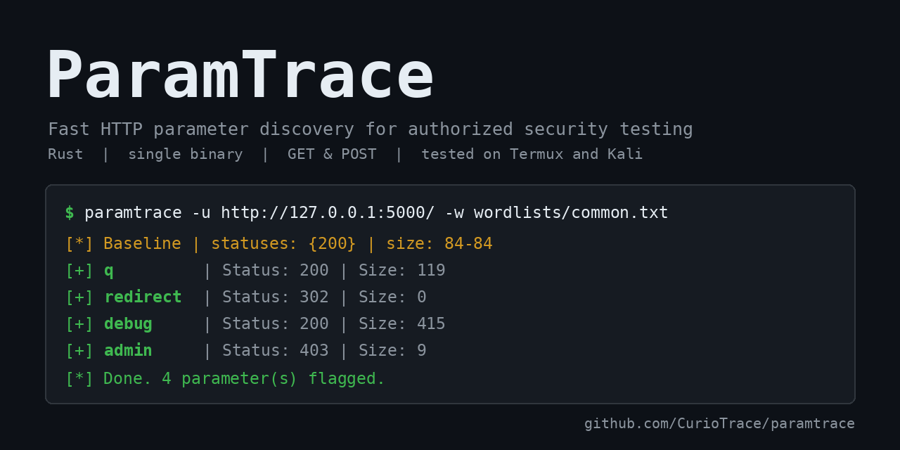
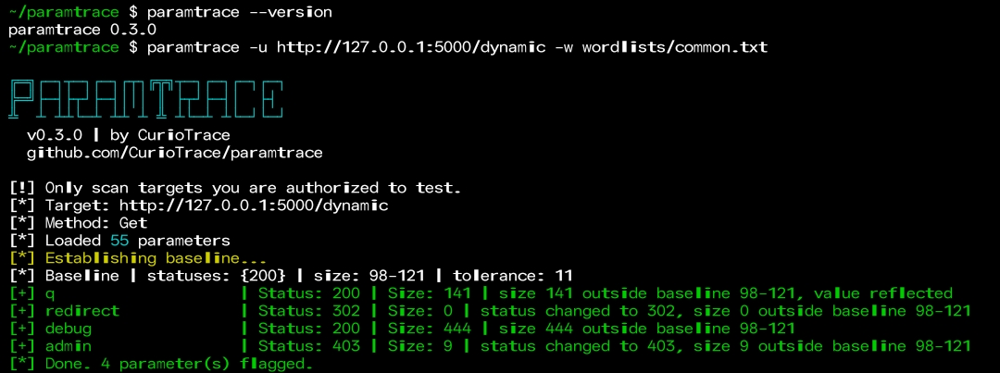

# ParamTrace

Fast HTTP parameter discovery for bug bounty and authorized penetration testing.
ParamTrace sends wordlist entries as parameters and flags the ones that change the
response compared to a baseline.

> **Legal notice:** only use ParamTrace on systems you own or have explicit written
> permission to test (for example, in-scope bug bounty targets). You are responsible
> for how you use it.

## Why ParamTrace?

Parameter discovery tools already exist (Arjun, x8, Param Miner for Burp). ParamTrace is a small, focused alternative:

- **Single binary, no runtime.** Written in Rust, so there's no Python environment or Burp needed. It also builds and runs on Termux (Android).
- **Noise-aware baseline.** It sends 3 random-parameter requests first to learn the normal status and size range, and `--tolerance` handles pages that change on every request.
- **Reflection detection.** It flags parameters whose value appears in the response, even when status and size barely change.
- **Fits your workflow.** Custom headers, GET and POST, proxy support (Caido or Burp), and JSON output you can pipe into other tools.
- **Small and readable.** The whole tool is one source file, so it's easy to audit and extend.

**When to use something else:** if you already live in Burp, Param Miner is a better fit. For batching many parameters per request, mature tools like Arjun or x8 are faster today. Batching is on the ParamTrace roadmap.

## How it works

1. Sends 3 requests with random fake parameters to learn the "normal" response
   (status codes and size range).
2. Tests each wordlist entry with bounded concurrency.
3. Flags a parameter when the status changes, the body size leaves the baseline range,
   or the value is reflected in the response.

## Install

Pre-built binaries (Linux x86_64 and aarch64, macOS Apple Silicon, Windows) are on the [Releases page](https://github.com/CurioTrace/paramtrace/releases), each with a `.sha256` checksum file. For example, on Linux (use the `aarch64` file for Kali NetHunter on a phone):

```bash
tar -xzf paramtrace-*-linux-x86_64.tar.gz
sudo cp paramtrace-*-linux-x86_64/paramtrace /usr/local/bin/
```

Termux uses Android's C library, so the Linux binaries won't run there. Install from source instead: `cargo install --git https://github.com/CurioTrace/paramtrace`

Or build from source:

```bash
git clone https://github.com/CurioTrace/paramtrace
cd paramtrace
cargo build --release
# binary: target/release/paramtrace

# optional: install it so you can just type `paramtrace`
cargo install --path .
```

Tested on Termux (Android) and Kali NetHunter. It should build anywhere Rust does (uses rustls, no OpenSSL needed).

## Usage



> The examples below assume `paramtrace` is on your PATH (see `cargo install --path .` above).
> If you only ran `cargo build --release`, use `./target/release/paramtrace` instead.
> If the command isn't found after installing, add Cargo's bin folder to your PATH:
> `export PATH="$HOME/.cargo/bin:$PATH"`

```bash
paramtrace -u https://example.com/search -w wordlists/common.txt
paramtrace -u https://example.com/api -w words.txt -m post -t 20
paramtrace -u https://example.com/ -w words.txt -H "Cookie: session=abc" --proxy http://127.0.0.1:8080
paramtrace -u https://example.com/ -w words.txt -o out.json -f json
```

| Flag | Description |
|------|-------------|
| `-u, --url` | Target URL |
| `-w, --wordlist` | Parameter wordlist |
| `-m, --method` | `get` (default) or `post` |
| `-t, --threads` | Concurrent requests (default 10) |
| `-H, --header` | Extra header, repeatable |
| `--timeout` | Request timeout in seconds (default 10) |
| `--delay` | Delay per request in ms |
| `--tolerance` | Ignore size differences up to N bytes (useful on dynamic pages) |
| `--value` | Value sent for each parameter (values under 4 characters disable the reflection check) |
| `--proxy` | Proxy URL (Caido, Burp) |
| `-k, --insecure` | Skip TLS verification |
| `-q, --quiet` | Hide the startup banner |
| `-o, --output` / `-f, --format` | Save results as `text` or `json` |

## Example result

Tested against my own instance of a PortSwigger Web Security Academy lab: with a 6,454-entry wordlist (6,453 wrong names plus the real parameter `productId`), ParamTrace flagged only `productId`, with no false positives, in about 3 minutes at 10 threads. The server answered `400` both with and without the parameter, so a status-code-only check would have missed it. ParamTrace caught it by comparing response sizes.

Speed depends heavily on the network, and parameter names are case-sensitive, so the wordlist must contain the exact name the server expects.

## Limitations

- Tests one parameter per request (batching is planned).
- On pages that change size on every request, the automatic tolerance can hide real changes smaller than the noise (status changes, larger size changes and reflection are still caught). Use `--tolerance 0` to compare exactly.
- Does not follow redirects, so redirect differences count as findings.

## Wordlists

A small starter list is in `wordlists/common.txt`. For larger ones, see
[SecLists](https://github.com/danielmiessler/SecLists).

For real targets, download a larger list (about 6,000 names) and scan gently:

```bash
curl -L -o wordlists/burp-params.txt https://raw.githubusercontent.com/danielmiessler/SecLists/master/Discovery/Web-Content/burp-parameter-names.txt
paramtrace -u https://example.com/page -w wordlists/burp-params.txt -t 5 --delay 100
```

**Parameter names are case-sensitive.** A server that expects `productId` will not react to `productid`, so ParamTrace can only find names that are in your wordlist with the exact spelling the target uses. Many lists are all lowercase, so check yours first, for example: `grep -c -x productId yourlist.txt`.

## License

MIT
